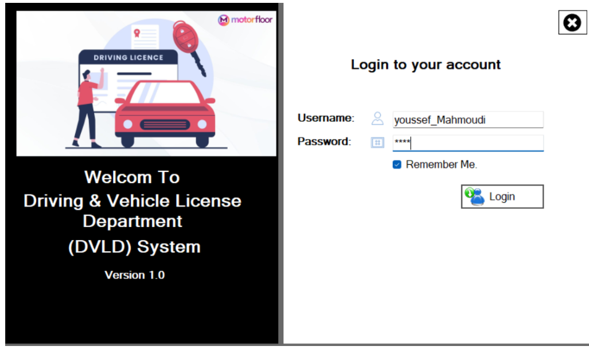
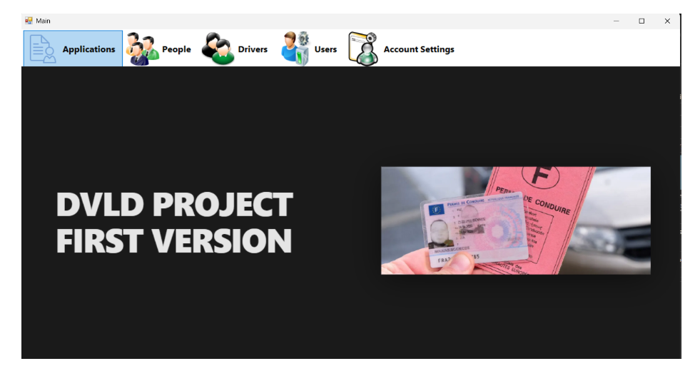
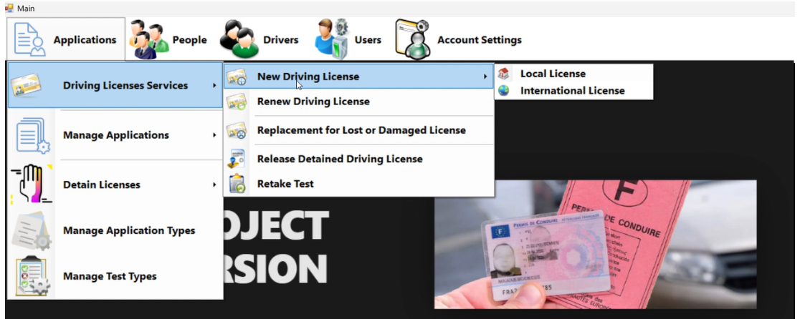

# DVLD — Driving & Vehicle License Department System

A desktop application for managing driving license services, applicant records, driver profiles, license applications, examinations, renewals, and license detentions.

**Version 1.0 · Desktop Application**

---

## 📸 Screenshots

### Login
Secure user authentication with username and password, including a *Remember Me* option.

### Main Dashboard
A centralized interface providing quick access to Applications, People, Drivers, Users, and Account Settings.

### Applications Menu
A dedicated interface for accessing driving license services and managing applications.

---

## ✨ Key Features

### 🔐 Authentication & Account Management
- User authentication with username and password
- Remember Me functionality
- User account settings

### 📄 Driving License Applications

The system supports multiple driving license services:

- **New Driving License:** Local and international license applications
- **License Renewal:** Renew existing driving licenses
- **License Replacement:** Replace lost or damaged licenses
- **License Release:** Process the release of detained driving licenses
- **Retake Examination:** Manage applications for retaking tests

### 📋 Application Administration
- Manage and track license applications
- Detain and release driving licenses
- Configure application types and associated fees
- Configure examination types and associated fees

### 👥 People Management
- Add, update, search, and delete personal records
- Maintain centralized applicant information

### 🚘 Driver Management
- Manage driver profiles linked to personal records
- Access driver information and associated license records

### 🛠️ User Management
- Manage system user accounts
- Maintain user information and account status

---

## 🧰 Technology Stack

- **Programming Language:** C#
- **Desktop UI:** Windows Forms
- **Framework:** .NET
- **Database:** Microsoft SQL Server
- **Architecture:** Three-Tier Architecture
  - Presentation Layer
  - Business Logic Layer
  - Data Access Layer

---

## 🏗️ Architecture

The application follows a three-tier architecture to separate user interface responsibilities, business rules, and database operations.

| Layer | Responsibility |
|---|---|
| Presentation Layer | User interface and user interactions |
| Business Logic Layer | Business rules, validation, and application processing |
| Data Access Layer | Database operations and data persistence |

This separation improves code organization, maintainability, and the ability to extend the application.

---
---

## 🗺️ Future Improvements

Potential enhancements for future versions include:

- [ ] Reports and statistical dashboards
- [ ] Printable driving license cards and documents
- [ ] More granular role-based access control
- [ ] Multilingual user interface
- [ ] Enhanced application tracking and reporting

---

## 👨‍💻 Author

**Youssef Mahmoudi**

- GitHub: [@youssefmahmoudi123](https://github.com/youssefmahmoudi123)

---

